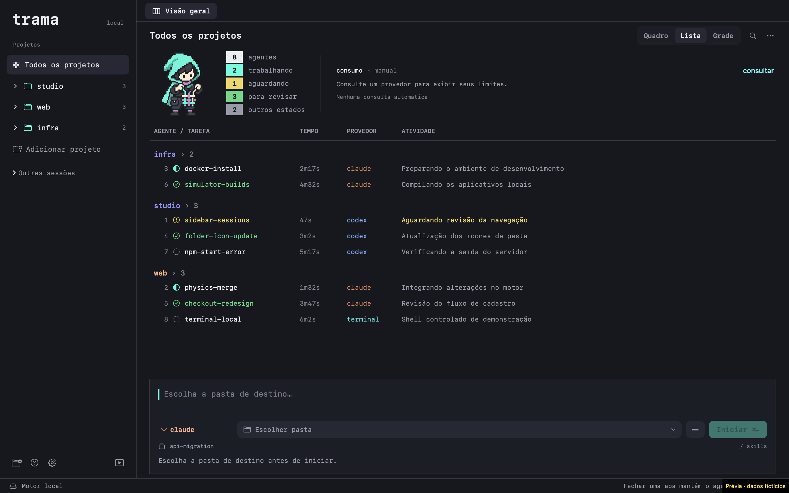

# Trama

**Seus projetos e agentes, em um só lugar.**

Trama reúne projetos locais, agentes de código e terminais em um aplicativo nativo para macOS. Acompanhe vários CLIs mantendo o contexto de cada pasta, tarefa e alteração.

**Projeto pessoal · prévia funcional em desenvolvimento · macOS 14+**



Captura das views nativas com dados fictícios de portfólio; os provedores mostrados não foram executados. [Vídeo de apresentação e roteiro](docs/PORTFOLIO_DEMO.md).

## O que você pode fazer

- **Organizar por projeto:** projetos, sessões e agentes na lateral, com abas e rascunhos preservados.
- **Trabalhar pelo terminal:** iniciar CLIs instalados, enviar instruções, encerrar e recuperar sessões interrompidas.
- **Acompanhar em conjunto:** quadro, lista e grade com duas ou seis prévias.
- **Revisar alterações:** worktrees, diffs e comentários com prévia e confirmação de envio.
- **Retomar o contexto:** histórico, exportação de logs, inbox e consulta manual de PR/CI pelo GitHub CLI.

O modo **Demonstração** mantém dados fictícios identificados separados das sessões reais. [Fluxo da área de trabalho](docs/WORKSPACE_FLOW.md).

## Como foi construído

| Camada | Implementação |
| --- | --- |
| Interface nativa | Swift 6, SwiftUI e AppKit |
| Terminal | SwiftTerm, com revisão fixada |
| Estado e persistência | Núcleo Swift independente das views, arquivos locais, locks e gravação atômica |
| Motor de sessões | Adaptador Rust sobre a biblioteca `orkai` do Octo, com revisão fixada |
| Comunicação | RPC JSON entre o aplicativo e o processo `trama-engine` |

O Trama desenvolve a interface e a integração nativa, reutilizando o motor do Octo para CLIs, PTY e logs. Não há paridade completa com o Octo. [Arquitetura e contratos](docs/ENGINE_INTEGRATION.md).

No [estudo de memória](docs/MEMORY_VALIDATION.md), duas prévias usaram **16,5% menos memória após carga** que seis, no processo que hospeda a interface de teste. A extração do histórico reduziu o pico do RPC em **8,6%**. Medições controladas em uma máquina, sem incluir a memória dos provedores.

## Executar localmente

Requisitos: **macOS 14+, Swift 6 e Rust**. Validado com Swift 6.1.2 e Rust 1.99.1. O primeiro build baixa dependências.

```sh
git clone https://github.com/lzAmaral/Trama-AI.git
cd Trama-AI
./scripts/build-engine.sh
swift run Trama
```

Para gerar e abrir um bundle otimizado:

```sh
./scripts/package-app.sh --release
open .build/Trama.app
```

Bundle com assinatura ad hoc de desenvolvimento, sem notarização. [Empacotamento](docs/PACKAGING.md).

1. Cadastre uma pasta e confira o destino no compositor do rodapé.
2. Escreva a tarefa, escolha um provedor instalado e clique em **Iniciar agente** (⌘Return).
3. Acompanhe o terminal na aba aberta. **Novo agente** (⌘N) retorna ao compositor.

Os CLIs precisam estar instalados, autenticados e disponíveis no `PATH` do aplicativo, que pode diferir ao abrir pelo Finder. Detectar o executável não comprova login ou compatibilidade.

**Fechar a aba ou a janela não encerra os agentes.** Use **Encerrar** no menu do agente. A execução pode modificar arquivos, enviar dados ao provedor e consumir créditos; as aprovações do CLI permanecem no terminal.

## Dados e estado da versão

Os dados ficam em `~/Library/Application Support/Trama`. Logs e notas podem conter informações sensíveis. As métricas do [piloto](docs/PILOT.md) são locais e começam desativadas.

A consulta de consumo é manual e pode acessar credenciais e a rede do provedor. Sem bypass de permissões, acesso remoto ou atualizações automáticas. [Segurança](docs/SECURITY.md).

Permanecem pendentes a validação autenticada por provedor, a revisão interativa completa, VoiceOver e a distribuição notarizada. Veja a [validação para apresentação](docs/PORTFOLIO_VALIDATION.md), o [roadmap](docs/ROADMAP.md) e os [critérios de entrega](docs/RELEASE_VALIDATION.md).

## Validar e contribuir

```sh
./scripts/build-engine.sh
./scripts/cargo-local.sh test --locked --manifest-path Engine/Cargo.toml
TRAMA_TEST_ENGINE_PATH="$PWD/Engine/target/debug/trama-engine" swift test --no-parallel
PYTHONDONTWRITEBYTECODE=1 python3 -m unittest discover -s scripts/tests -v
git diff --check
```

Os testes usam shells e Git temporários, sem IA paga ou consultas autenticadas. O CI verifica também empacotamento e avisos de dependências. [Evidências](scripts/VALIDATION.md) · [Engenharia](docs/ENGINEERING.md) · [Colaboração](AGENTS.md).

## Créditos

O motor deriva da biblioteca Rust do [Octo](https://github.com/lucasmarujo/octo, fixada em `f66aa854313026870aaf57f65d26d9cbfbf32269`. O terminal usa [SwiftTerm](https://github.com/migueldeicaza/SwiftTerm). Revisões, origens e licenças estão em [ThirdPartyNotices](ThirdPartyNotices/README.md).

## Licença

O código próprio do Trama é distribuído sob a [licença MIT](LICENSE). Código e ativos de terceiros mantêm suas respectivas licenças e avisos, incluindo os registrados em [ThirdPartyNotices](ThirdPartyNotices/README.md) e na [landing page](sites/trama/README.md).
